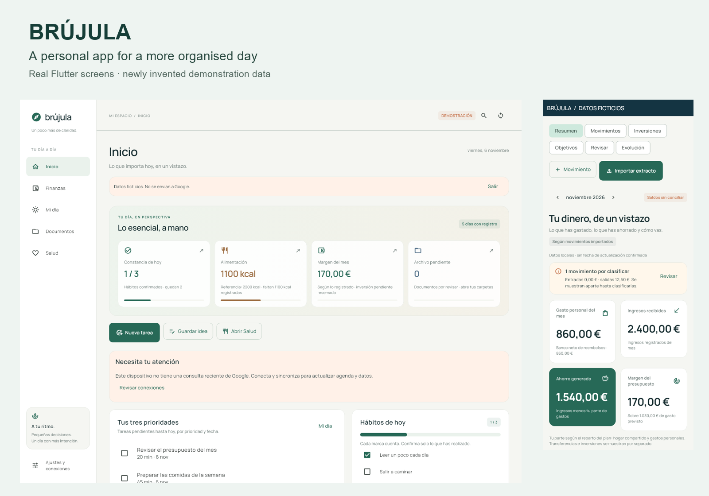
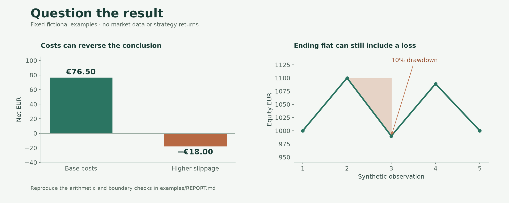

# Hi, I'm Martin

I studied Mathematics in Finance and Industry in Germany and have worked in financial research at Rankia and leasing contract management at Volkswagen. I enjoy turning a practical question into something I can use, inspect and improve.

These are two of my personal projects. **Start with the product tours; the selected code and tests are there if you want to go deeper.** All records and results in the demonstrations are fictional.

## Brújula

**My day, my plans and my finances in one place.**

Brújula began as an app for my own organisation. It grew to connect daily priorities, financial records, documents and wellbeing. The interesting work is in the details: keeping a transfer out of spending, preserving a genuine repeated purchase, or showing an incomplete record honestly.

[Explore Brújula →](brujula-finance-case-study/README.md) · [Full product tour](brujula-finance-case-study/docs/PRODUCT_TOUR.md) · [Worked examples](brujula-finance-case-study/docs/EXAMPLES.md)

## Financial research and validation

**A way to question a result before trusting it.**

My personal Python research project brings together simulation, cost assumptions, portfolio metrics and operational records. This case shows both sides: numerical validation and the dashboard used to inspect orders, fills and reconciliation.

[Explore the research project →](financial-research-validation/README.md) · [Dashboard tour](financial-research-validation/docs/PRODUCT_TOUR.md) · [Reproduce the calculations](financial-research-validation/examples/REPORT.md)

## How I work

Both projects were developed with AI assistance. I define needs and constraints, work through changes, investigate problems and review the outputs with tests. The samples distinguish extracted application code from new demonstration helpers. I am continuing to build my programming skills alongside my current data and AI programme.

I am interested in financial analysis, automation and fintech product or implementation roles, especially where German and English are useful.

[LinkedIn](https://www.linkedin.com/in/martin-calpe-blasco)

Portfolio scope and access

The complete applications, personal data and current trading strategies remain outside this repository. The project folders contain selected runnable samples and demonstrations. Neither project is presented as an enterprise deployment or evidence of investment performance. This repository currently remains private; access must be arranged before sending these links to a recruiter.

