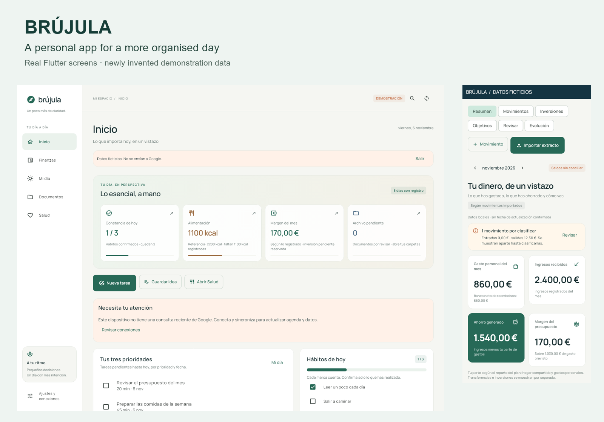
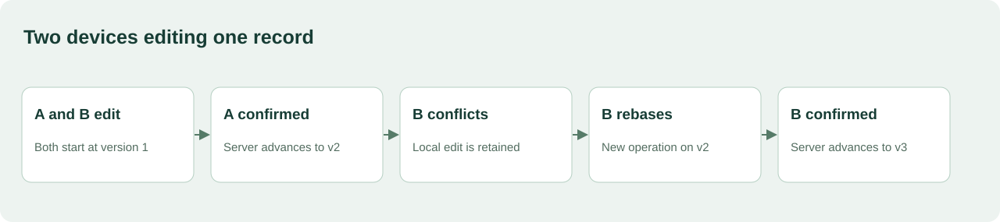

# Brújula

Flutter/Dart application for personal management, finances, documents and daily planning.

I built Brújula to organise my own life, be more productive and keep my finances together. It grew from those everyday needs: reviewing a bank import, finding a document, planning the week and seeing progress without maintaining separate lists.



**[Product tour →](docs/PRODUCT_TOUR.md)** · [Technical notes](docs/TECHNICAL.md) · [Source provenance](docs/PROVENANCE.md)

## How it works

The full app uses Flutter/Dart, local working records and a Google Apps Script backend. Financial records, documents, habits and plans share the same workspace. The gallery also covers study tracking, meals, pantry stock and wellbeing.

This folder contains two executable modules:

- **Import review:** parse monetary values, compare incoming financial rows with their originals and classify each as new, duplicate, possible match or conflict.
- **Synchronization:** model two devices editing one record, retain local changes on conflict, retry an operation after a lost response and resolve against the latest version.

## Key design decisions

### Preserve the meaning of a transaction

Two €2.50 coffees can both be real. Matching descriptions and amounts trigger review; a common reference or source-file row provides stronger identity. Repeated references and multiple strong candidates remain explicit conflicts, rather than selecting a convenient match.

The parser validates signs and grouping before converting to integer cents. `-1.234,56 EUR` becomes `-123456`; `12-3` is rejected. Currency remains explicit.


*Synthetic demo data. The two priced holdings show a combined €180 gain; the unpriced holding stays separate.*

### Keep a pending edit until it is confirmed

The synchronization demo starts both devices at version 1. Device A's accepted edit creates version 2. Device B keeps its local edit when the server detects a conflict. Choosing to keep it creates a new operation based on version 2. Replaying A's original operation after a lost response does not write it twice.



*Sequence of the standalone demo, based on the app's version and receipt workflow.*

## Demo

Requires Dart **3.13.5**. Run from this folder:

```sh
dart pub get --enforce-lockfile
dart run bin/demo.dart
dart run bin/sync_demo.dart
```

The import demo prints the four review outcomes. The sync demo ends at version 3 with no pending changes. Both use synthetic data and run locally after dependencies are installed.

## Tests

```sh
dart format --output=none --set-exit-if-changed lib bin test
dart analyze
dart test
```

Tests cover malformed amounts, repeated purchases, reference collisions, file reimports, deterministic matching, version conflicts, restart snapshots and idempotent retries. The full Flutter application and connected Google services remain outside these modules.

## En español

Brújula nació para organizarme mejor y reunir mis finanzas. El recorrido muestra la aplicación real con datos ficticios. Las dos muestras permiten ejecutar la revisión de importaciones y un conflicto de sincronización entre dispositivos.

[Rights](RIGHTS.md) · [Third-party notices](THIRD_PARTY_NOTICES.md)
