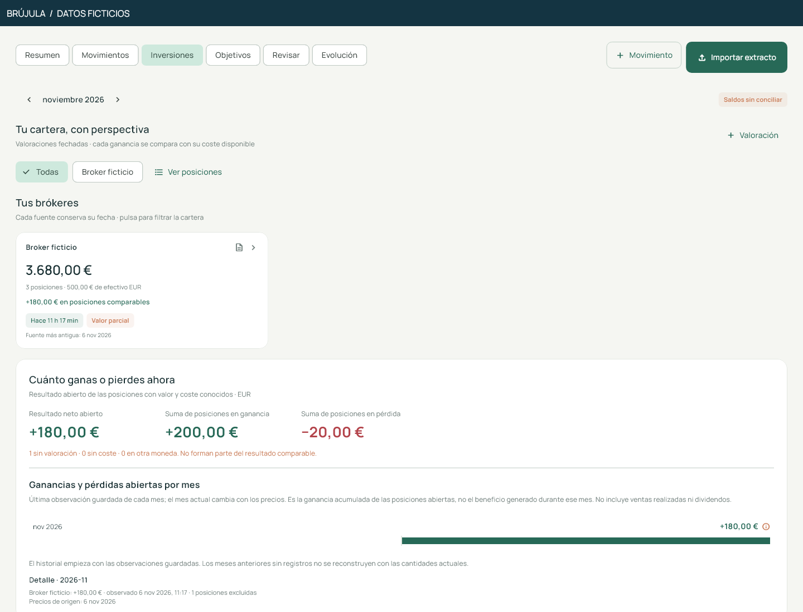
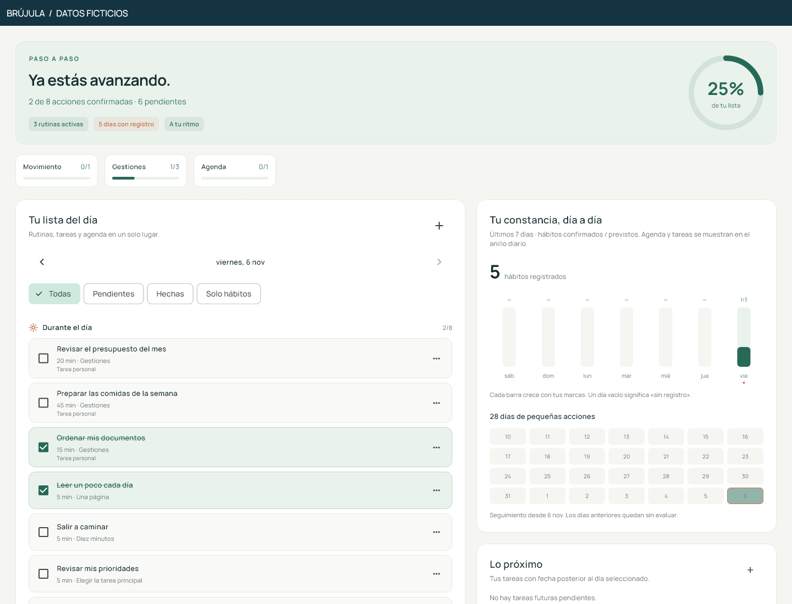
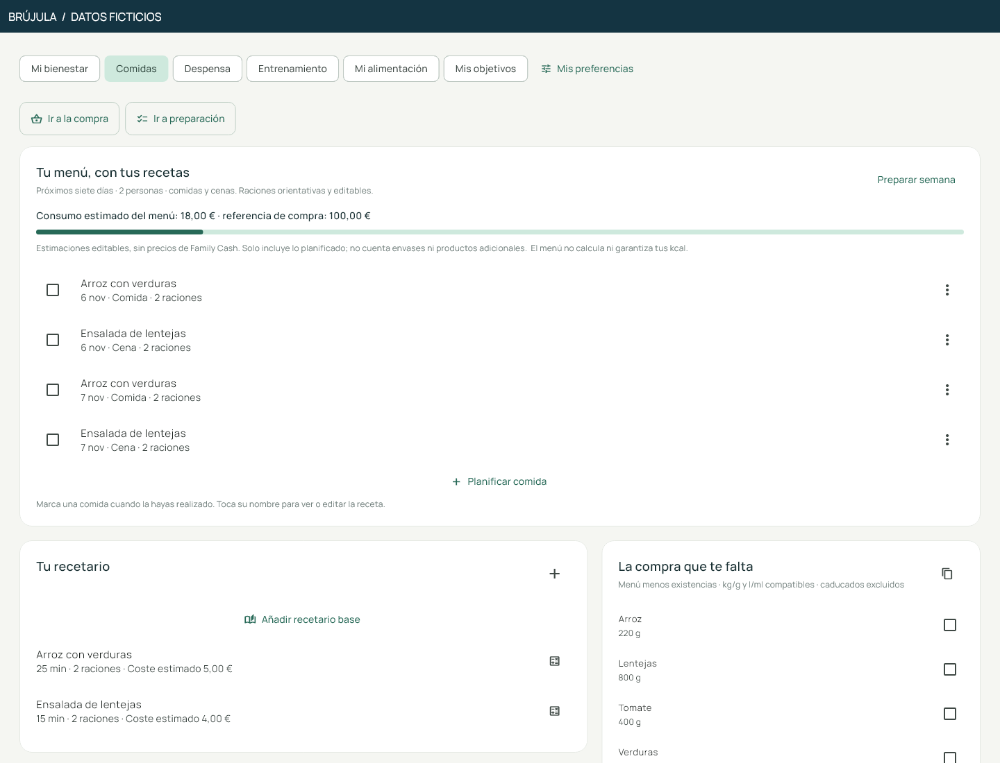

# Brújula

### A personal app for organisation, productivity and finances

I started Brújula to organise my own life: what I needed to do, how I was spending my time and where my money was going. It was originally just for me. As those needs became connected, the app grew beyond a task list into a shared workspace for daily plans, finances, documents and wellbeing.


**[Take the product tour →](docs/PRODUCT_TOUR.md)** · [See the worked examples](docs/EXAMPLES.md) · [Run the selected code](#try-the-import-review-sample)

## What you can explore

| A question I wanted to answer | What Brújula brings together |
|---|---|
| What matters today? | A daily overview, priorities, tasks, habits and a calendar workspace. |
| Where is my money going? | Transaction review, budgets, refunds, transfers and investment views. |
| Am I making progress? | Savings goals, habit consistency and academic assessment tracking. |
| Where did this information come from? | Document records, extracted facts and links back to their source. |
| How do I plan the week? | Meals, recipes, pantry stock, shopping needs and personal wellbeing records. |
| What happens when a change cannot sync? | A local working copy, pending changes, version checks and explicit conflict handling. |

### Finance with context

The financial workspace separates spending from transfers and investments. It keeps records that still need classification visible and excludes an asset with an unknown value from a misleading gain calculation.



### A useful daily routine

Tasks and habits share the same workspace. Weekly consistency shows the pattern behind a single day; planning a task or a workout is kept distinct from completing it.



### Planning beyond money

The meal planner uses recipes and pantry stock to build shopping needs. Document and study workspaces make information easier to find and review. The [full tour](docs/PRODUCT_TOUR.md) includes these screens, wellbeing and mobile layouts.



## What I worked on

I defined the workflows and the details I wanted the app to get right, developed and revised it with AI assistance, and worked through debugging and validation. The application uses Flutter/Dart with a Google Apps Script backend. This portfolio exposes a small part of the financial review logic, accompanied by real application renders with newly invented data.

The selected sample has **12 automated tests**. A separate local widget test rendered the 15 new gallery views without reported widget exceptions. These are checks of selected behaviours, rather than a test of every feature or an assessment of individual programming proficiency.

## Try the import review sample

The runnable code demonstrates four outcomes: **new record, duplicate, possible match and conflict**. Two identical purchases can still be legitimate; a reference reused with a different amount deserves investigation.

With Dart 3.13 or newer:

```sh
dart pub get --enforce-lockfile
dart analyze
dart test
dart run bin/demo.dart
```

This sample needs no bank connection or Flutter installation. See [the examples](docs/EXAMPLES.md), [test cases](test/finance_review_test.dart) and [source provenance](docs/PROVENANCE.md).

<details><summary>Architecture, demonstrations and scope</summary>

- [Architecture and synchronization decisions](docs/ARCHITECTURE.md)
- [Financial case study](docs/CASE_STUDY.md)
- [Complete gallery and capture method](media/APP_SCREENSHOTS.md)
- [Illustrated import walkthrough](media/WALKTHROUGH.md)
- [Capabilities and evidence boundaries](docs/CAPABILITIES.md)

All gallery data was invented for this portfolio. The screens are rendered from the app's widgets, not design mockups. The wider app contains external integration code; this demonstration does not connect to Google, a bank or a broker. Full application source and personal records remain private.

</details>

## En español

Brújula nació para organizarme mejor, ser más productivo y tener mis finanzas en un mismo sitio. La galería muestra la amplitud real de la app con datos inventados; los ejemplos y el código seleccionado permiten revisar decisiones concretas sobre importaciones, duplicados y trazabilidad.

Copyright 2026 Martin Calpe Blasco. All rights reserved. [Rights](RIGHTS.md) · [Third-party notices](THIRD_PARTY_NOTICES.md).
