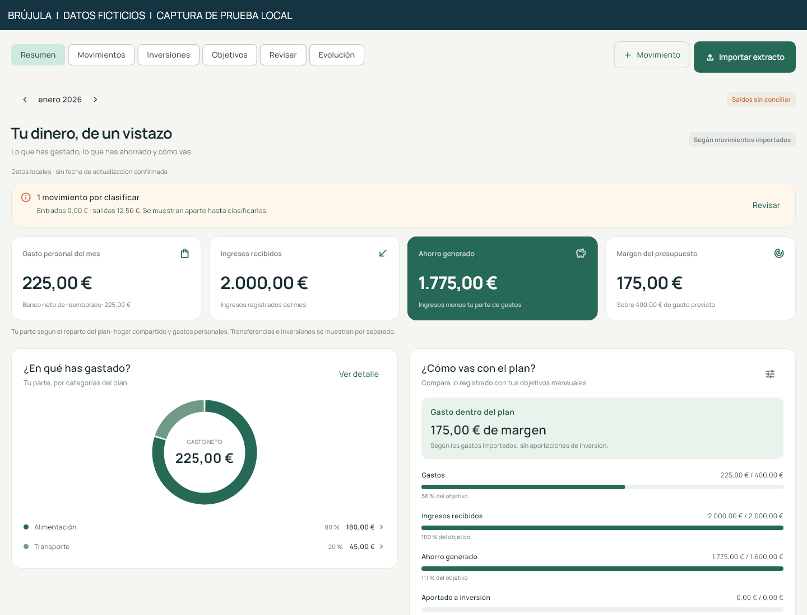

# Brújula | Financial data quality

**A bank import should preserve real transactions and make uncertain matches visible.**
This case study shows how I approached that problem in Brújula, my private personal app.



## What I worked on

I defined the financial workflows, developed parts of the application with AI assistance,
and reviewed and tested the results. The full app uses Flutter/Dart and Google Apps Script.
This repository contains a small Dart extraction of its import-review logic, not the full app.
It is a portfolio sample, not a commercial deployment or a security certification.

## What this sample demonstrates

- Integer cents for money and explicit currency rather than silent currency conversion.
- Distinct outcomes for new records, confirmed duplicates, possible matches and conflicts.
- Preservation of repeated legitimate purchases, original data and account identity.

The full app also uses pending operations, version checks and receipts for synchronization.
The design is explained in [the architecture note](docs/ARCHITECTURE.md); that backend is not included.

## Run the selected logic

Install Dart 3.8 or newer (the sample was checked with 3.13.5), then run:

```sh
dart pub get --enforce-lockfile
dart analyze
dart test
dart run bin/demo.dart
```

The demo prints four synthetic records: `fresh`, `duplicate`, `possible`, `conflict`.
It needs no account, bank connection, credentials or Flutter installation.

## Explore

- [Case study and limitations](docs/CASE_STUDY.md)
- [Three real application renders with invented data](media/APP_SCREENSHOTS.md)
- [90-second illustrated logic walkthrough](media/walkthrough.gif)
- [Extracted source and modifications](docs/PROVENANCE.md)
- [Synthetic demo output](examples/demo-output.json)

All financial records shown here are fictitious. The app-summary, app-movements and app-review
PNGs are real local widget renders using newly invented data. The numbered import-review
illustrations and GIF explain the extracted CLI logic; they are not a recording of the full app.
Neither set demonstrates Google synchronization or a live bank integration.

## Resumen en español

Muestra de Brújula centrada en la calidad de datos financieros: importes en céntimos,
reimportaciones, duplicados y conflictos. Proyecto personal desarrollado con asistencia
de IA; incluye código seleccionado y pruebas con datos ficticios. La aplicación completa,
sus conexiones y los datos personales permanecen privados.

## Rights and dependencies

Copyright 2026 Martin Calpe Blasco. All rights reserved; no open-source license is granted
for the project code or case-study material. GitHub's viewing/forking terms still apply.
See [RIGHTS.md](RIGHTS.md) and [THIRD_PARTY_NOTICES.md](THIRD_PARTY_NOTICES.md).
