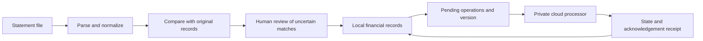

# Brújula financial workflow

The public code covers money normalization and structured-row matching only.
The full private application separately queues operations and waits for state plus receipts
before discarding pending changes. Version conflicts remain visible rather than silently
overwriting another device. A lost response must not be treated as proof that an operation failed.

This diagram is descriptive. It does not publish the cloud implementation or certify its security.
