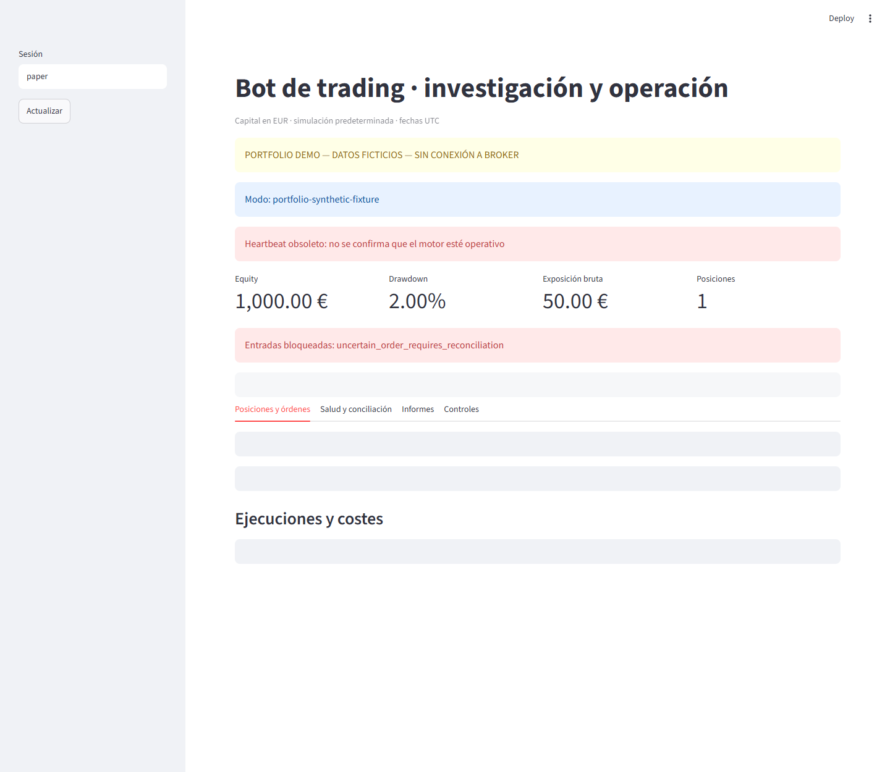

# Financial research and validation

### From an attractive result to a result I can question

This is my personal research project for exploring financial hypotheses and the assumptions behind them. It brings together simulation, costs, currencies, portfolio metrics and operational records. I use it to investigate why a result changes, including when a promising idea should be set aside.


**[Explore the dashboard →](docs/PRODUCT_TOUR.md)** · [Check the calculations](examples/REPORT.md) · [Run the selected sample](#reproduce-the-sample)

## Two parts of the same problem

| Research | Operational visibility |
|---|---|
| Compare outcomes after costs and currency conversion. | Inspect positions, orders and individual fills. |
| Measure losses from initial capital and previous peaks. | Make uncertain order responses visible. |
| Keep development and reserved evaluation periods separate. | Review reconciliation, status and audit records. |
| Record a hypothesis that was not promoted. | Distinguish a queued control request from an executed action. |

The wider platform also has portfolio-research reports, passive comparisons and historical cycle diagnostics. [The research workflow](docs/RESEARCH_WORKFLOW.md) explains these capabilities without disclosing the current strategy.

The gallery below runs the actual Streamlit dashboard against a new isolated fictional ledger. It has **no broker connection**. The stale-heartbeat warning is deliberately visible: a stopped engine must not look operational.



## A result you can verify by hand

The base example starts with 100 quote-currency units of gross profit. After fees of 10 and slippage of 5, conversion at 0.90 EUR per quote unit leaves **€76.50**. Raising slippage to 110 changes the same example to **−€18.00**. These are fixed fictional scenarios, not trading returns.

The sample also checks partial exits, daily boundaries, drawdown and a chronological split. The [worked report](examples/REPORT.md) sets out the conventions and expected answers.

## What I worked on

I define the research questions and constraints, develop and revise the project with AI assistance, and review its outputs, assumptions and tests. The wider private project uses Python, pandas, transactional storage and simulation tools. This repository contains two extracted metric functions and new synthetic validation helpers, with **11 automated tests**.

One documented global allocation hypothesis was not promoted because it lagged the passive reference over the examined full sample. [The methodology note](docs/METHODOLOGY.md) explains the decision and what cannot be independently reproduced from this sample.

## Reproduce the sample

With Python 3.12 and uv:

```sh
uv sync --frozen
uv run ruff check .
uv run pytest -q
uv run python demo.py
```

The fixed examples require no market-data subscription, broker account, API key or private file. Dependencies are installed first; the sample itself runs locally.

<details><summary>What is included and what remains private</summary>

- [Five actual dashboard captures and their interpretation](docs/PRODUCT_TOUR.md)
- [Methodology and rejected research direction](docs/METHODOLOGY.md)
- [Source provenance](docs/PROVENANCE.md)
- [Selected tests](tests/test_validation.py)
- [Research and operational evidence map](docs/CAPABILITIES.md)

Current strategies, entry and exit rules, parameters, account configuration and operational connectors are outside this repository. Sustainable live profitability has not been demonstrated; prospective observation and operational acceptance remain incomplete. The gallery verifies presentation against a synthetic fixture, not safe execution with real money.

</details>

## En español

Plataforma personal para investigar hipótesis financieras y revisar sus supuestos. La galería enseña las pantallas reales de posiciones, conciliación, informes y controles con datos ficticios. La muestra reproducible permite comprobar costes, divisas y métricas sin compartir estrategias ni presentar rentabilidades como reclamo.

Copyright 2026 Martin Calpe Blasco. All rights reserved. [Rights](RIGHTS.md) · [Third-party notices](THIRD_PARTY_NOTICES.md).
