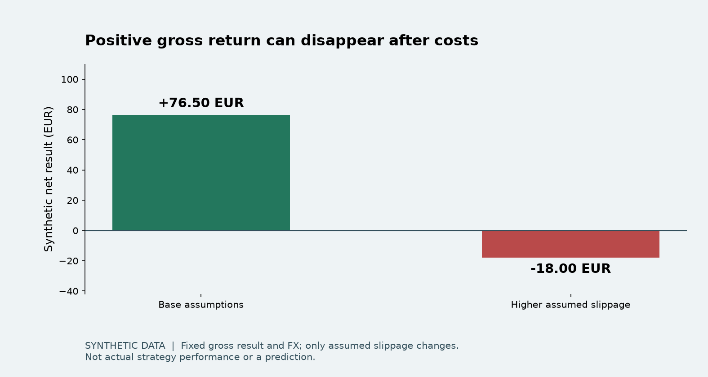

# Financial research | Testing the result, not selling a return

**A strategy can look profitable before costs and fail once execution assumptions change.**
This small case study shows how I validate that distinction in a private personal research project.



## My contribution

I define research questions and constraints, work on the implementation with AI assistance,
and review outputs, assumptions and tests. My wider private project uses Python, pandas,
transactional storage and simulation tools. This repository exposes selected metric functions
and a new synthetic teaching example, not the trading system or its current strategy.

## Inspect the evidence

- [Synthetic report with hand calculations](examples/REPORT.md)
- [Methodology, a rejected hypothesis and limits](docs/METHODOLOGY.md)
- [Source provenance and adaptations](docs/PROVENANCE.md)
- [Tests](tests/test_validation.py)

With Python 3.12 and uv:

```sh
uv sync --frozen
uv run ruff check .
uv run pytest -q
uv run python demo.py
```

Everything runs locally with fixed fictional data. No market-data subscription, network call,
broker account, API key or private file is needed after dependencies are installed.

## What the example checks

The base case is `(100 - 10 - 5) × 0.90 = 76.50 EUR`. Increasing the assumed slippage
to 110 reverses it to `-18.00 EUR`. Neither number is actual investment performance.
The sample also checks drawdown, daily closing boundaries, partial exits and chronological partitions.
Its partition test does not prove that the entire private research system is free of look-ahead bias.

## Resumen en español

Proyecto personal de investigación financiera desarrollado con asistencia de IA.
Esta muestra permite comprobar costes, divisas, métricas y separación temporal con datos
sintéticos. No publica estrategias ni demuestra rentabilidad futura, experiencia de trading
profesional o dominio avanzado de Python y SQL.

## Rights

Copyright 2026 Martin Calpe Blasco. All rights reserved; no open-source license is granted
for the sample or case-study material. GitHub's viewing/forking terms still apply.
See [RIGHTS.md](RIGHTS.md) and [THIRD_PARTY_NOTICES.md](THIRD_PARTY_NOTICES.md).
