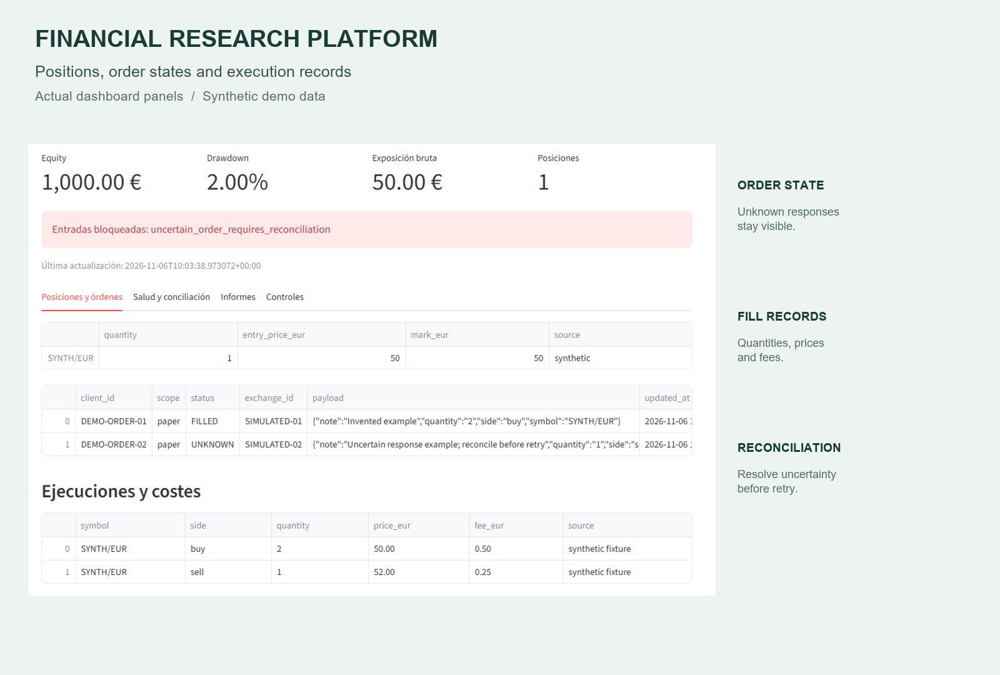
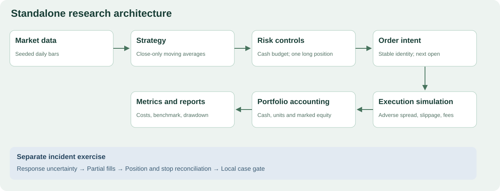
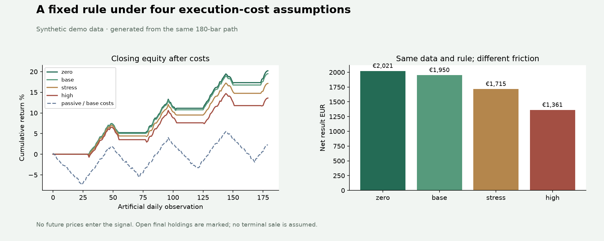
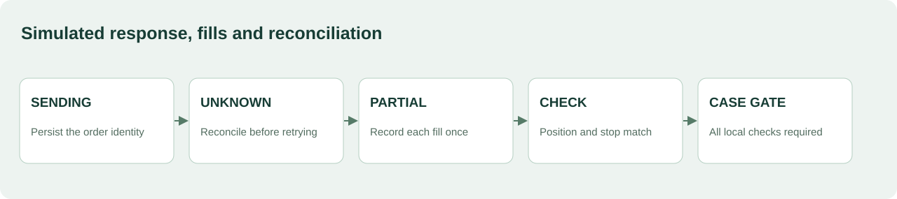

# Quantitative Trading Research Platform

Python research, event-driven simulation, portfolio accounting and order reconciliation.

## Overview

The wider personal platform investigates financial hypotheses and follows them through data, simulation, costs and risk controls. This folder makes a complete independent example runnable: a simple long/cash moving-average rule, a passive reference, an auditable ledger and a cost experiment.

**Synthetic demo data.** The dashboard tour shows the existing application interface; the backtest and incident models below run independently.



## Architecture



The research engine sizes whole-unit entries against available cash, processes orders chronologically and marks equity at each close. The separate incident model inspects response uncertainty, fill identity and protection for one order.

## Reproducible Backtesting Example

The question is simple: **what changes when the same rule and price path face higher execution costs?**

The dataset has 180 deterministic artificial daily bars, built from a fixed cycle, trend and seeded noise. Five- and twelve-bar averages use closes already observed. A signal at a close can trade only at the following open. The passive reference buys at the first open with the same initial cash, allocation, cost case and end date.

## Results

| Cost case | Return | Max closing DD | Completed / open trades | Execution costs | Passive return |
|---|---:|---:|---|---:|---:|
| zero | 20.21% | 2.15% | 3 / 1 | €0.00 | 2.38% |
| base | 19.50% | 2.16% | 3 / 1 | €67.48 | 2.29% |
| stress | 17.15% | 2.53% | 3 / 1 | €271.82 | 1.99% |
| high | 13.61% | 3.40% | 3 / 1 | €594.63 | 1.56% |



Every value comes from [the generated experiment](examples/backtest/REPORT.md), with [full-precision results](examples/backtest/summary.json), [fills](examples/backtest/fills.csv) and [equity](examples/backtest/equity.csv). The constructed cycles favour this elementary trend rule; these figures demonstrate accounting and sensitivity, not a measured market advantage. Final holdings are marked at the last close. No terminal sale or exit fee is assumed by default.

## Execution and Risk Controls



`execution_demo.py` follows an uncertain response through restart, duplicate acknowledgement, partial fill and cancellation. A late fill makes the earlier stop coverage insufficient. A fresh matching position and stop observation clears that incident; a conflicting fill identity remains quarantined.

The output shows the gate and its reasons at every event. `new_entries_allowed` is local to this one-order case. It does not approve aggregate portfolio exposure, capital requirements or additional real orders.

The resolved example has **€207 executed principal plus €1 fees: €208 total acquisition cost**. Fees are execution costs; principal is not.

## Technical Decisions

- **Reconcile before retrying an uncertain order.** A timeout does not establish rejection. [State handling](research_sample/execution.py) retains the order identity; [the timeout test](tests/test_execution.py) checks that the same intent cannot be submitted again.
- **Include friction in the ledger.** Fees apply to executed notional; spread and slippage alter fill prices and are not subtracted twice. [Backtest accounting](research_sample/backtest.py) is checked against [hand-calculated fills and equity](tests/test_backtest.py).
- **Give operations stable identities.** [Fill and response deduplication](research_sample/execution.py) ignore identical repeats and quarantine contradictions. [Tests](tests/test_execution.py) cover both cases; [entry IDs in metrics](research_sample/metrics.py) keep independent entries at the same time separate.

## Run Locally

Python **3.12.13**, uv **0.10.9**. From this folder:

```sh
uv sync --frozen
uv run python backtest_demo.py --check
uv run python execution_demo.py
```

To regenerate the experiment's CSV, JSON, Markdown and plot, run `uv run python backtest_demo.py`. `--check` recomputes and compares the committed numerical artefacts. The original small metric example is available with `uv run python demo.py`.

## Tests

```sh
uv run ruff check .
uv run pytest -q
```

Tests include future-price perturbations, signal/execution timing, hand-calculated fees and equity, missing data, open final positions, benchmark alignment, unique IDs, restart recovery and duplicate/conflicting observations.

[Methodology](docs/METHODOLOGY.md) · [Source provenance](docs/PROVENANCE.md) · [Dashboard tour](docs/PRODUCT_TOUR.md)

## En español

Proyecto personal de investigación cuantitativa y simulación. El ejemplo reproduce datos, señales, ejecución, contabilidad y comparación con una referencia pasiva. Un segundo ejercicio explica cuándo una orden queda bloqueada y cómo se concilia. Las estrategias actuales y las cuentas del sistema completo permanecen privadas.

[Rights](RIGHTS.md) · [Third-party notices](THIRD_PARTY_NOTICES.md)
