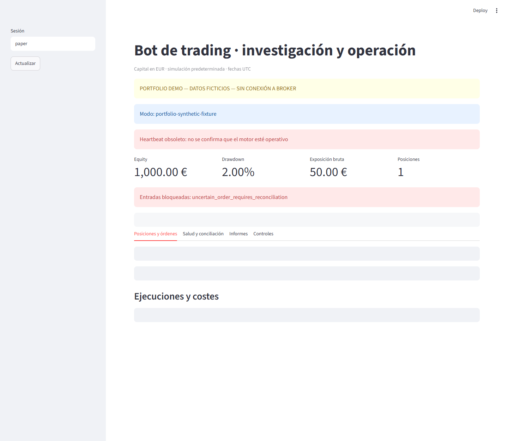
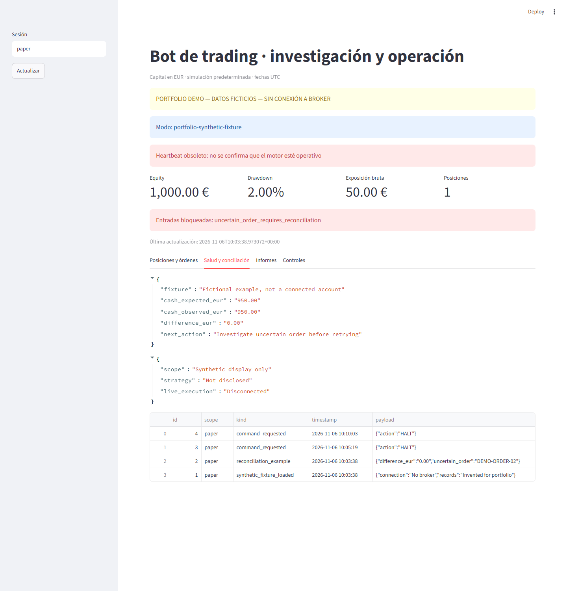
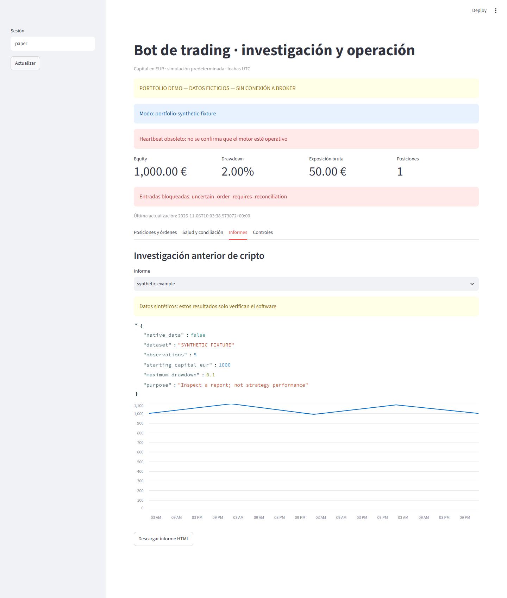
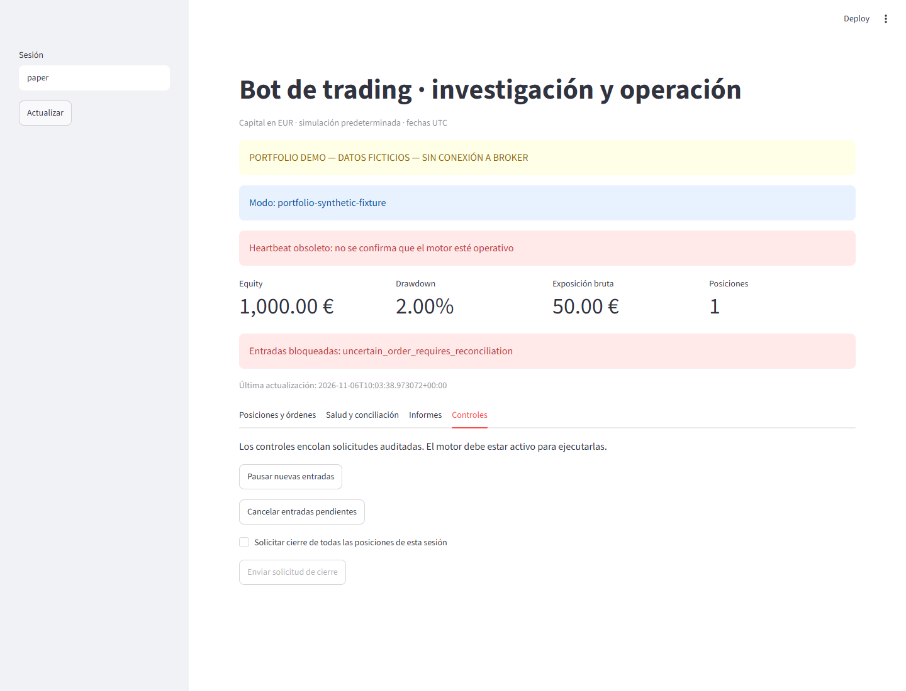
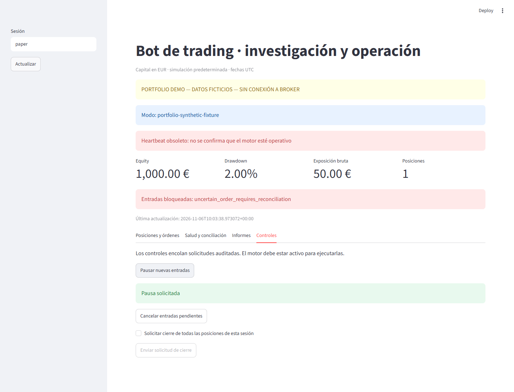
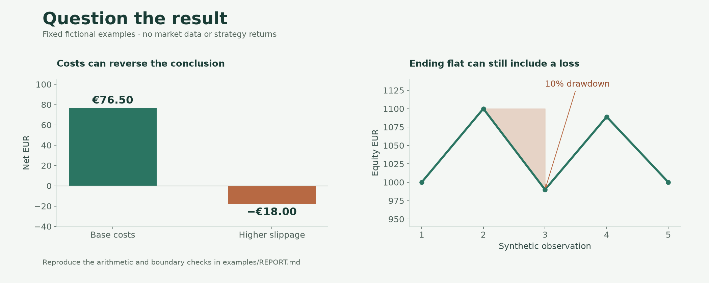

# A tour of the research dashboard

[Back to the project](../README.md) · [Worked calculations](../examples/REPORT.md)

These are captures of the **actual Streamlit dashboard**, using a new SQLite fixture populated with invented orders, fills, status and reports. A visible portfolio warning was added to a task-local copy. No operational account, market feed or broker was connected. The application remains in Spanish; the captions explain the workflow.

## Positions, orders and fills

The fictional ledger includes one filled order and one uncertain order. The latter remains UNKNOWN, with an explicit entry block. The fills retain quantities, prices and fees. These are independent display fixtures, not a reconciled history of a real account.

## Status and reconciliation

A fictional cash check shows expected and observed values, alongside an audit log. The heartbeat is stale because no execution engine is connected. A zero cash difference alone does not resolve the uncertain order.

## Inspect a research report

The report is visibly synthetic and contains five invented equity observations. Its 10% historical drawdown is separate from the independently seeded 2% status-card drawdown above. Neither series describes trading performance.

## Request an action deliberately

The dashboard describes controls as queued requests. A separate confirmation is required before requesting a close of all positions. A button click is not confirmation that the engine executed the request.

## See the request acknowledged

The pause request was submitted only to the isolated synthetic ledger and the UI acknowledged it. This demonstrates request submission and acknowledgement, not the stopping of an actual trading engine.

## Reading the numerical examples

The illustration above is a new explanatory chart, not a screenshot or a result from the private strategy. [The runnable report](../examples/REPORT.md) provides the underlying figures. The complete trading system and current strategies are not distributed.
