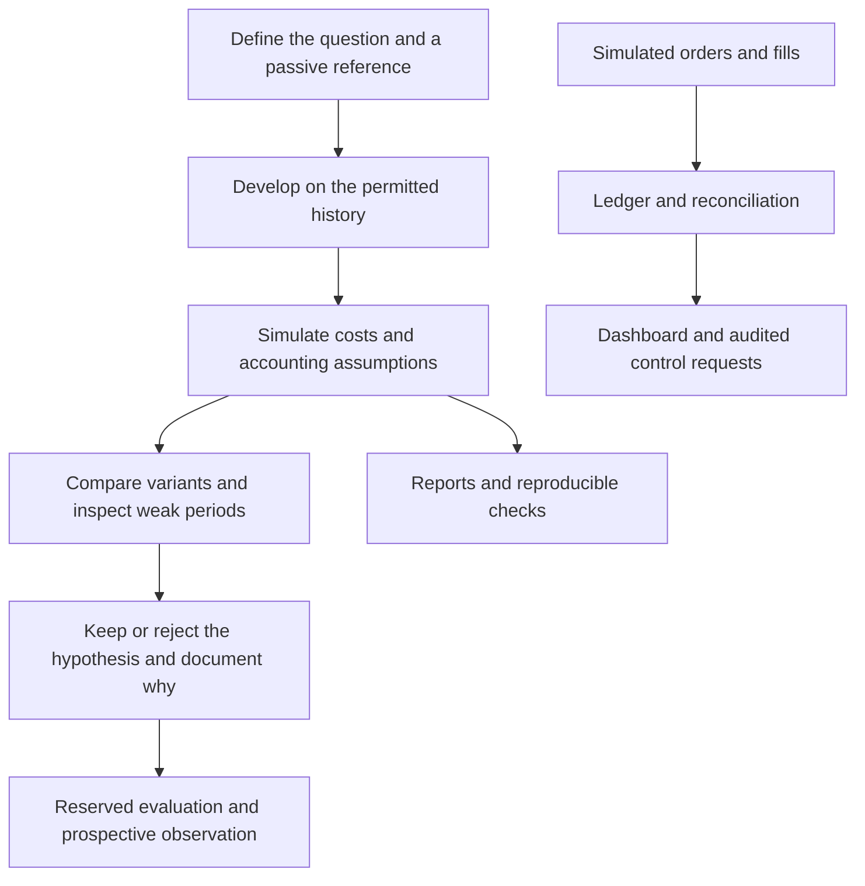

# From a research question to an inspectable result

[Back to the project](../README.md)

The wider private platform has more scope than the two functions extracted for this portfolio. Its dashboard includes reports for portfolio research, passive comparisons, cost scenarios and continuous histories across rising, falling and sideways periods. The current strategies and their parameters are deliberately outside this sample.

## Questions behind the reports

| Question | What the platform is designed to inspect |
|---|---|
| Is the idea better than a simple alternative? | Comparison with a passive reference over the same represented period. |
| Does it work beyond one favourable interval? | Continuous portfolio paths and historical period diagnostics. A regime assigned after the fact is not a predictive signal. |
| Does the conclusion survive execution assumptions? | Costs, currency conventions and simulated fills. |
| Am I repeatedly tuning to the evaluation set? | Development boundaries, reserved evaluation and recorded variants. A split helper alone does not settle that question. |
| What if an order response is unclear? | An explicit uncertain state, entry block, reconciliation and audit records. |
| Did a requested action actually happen? | Separate request acknowledgement, engine status and execution evidence. |

## A decision to leave an idea behind

One global allocation hypothesis improved a particular falling-market interval, but lagged the passive reference across the examined full sample. Reducing assumed costs did not settle that comparison. It was not promoted. Keeping that outcome is useful: it explains a research decision instead of selecting only an attractive interval for the portfolio.

That is a documented outcome from the private project. The complete market dataset and variant-selection process are not redistributed or independently reproduced here. The synthetic examples are separate, smaller checks that a reader can run.

## Current stage

This is a personal research and simulation platform. Sustainable live advantage has not been established. Reserved evaluation, prospective observation and operational acceptance must not be inferred from a chart or from a functioning dashboard. The portfolio exposes how selected assumptions are checked while protecting strategy logic and account information.
