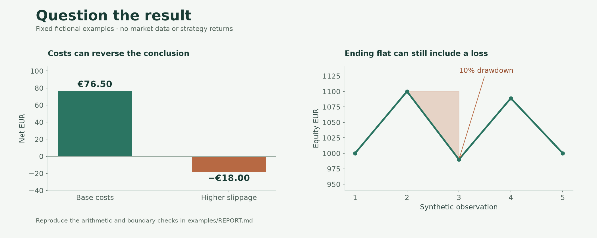

# Synthetic validation report

Every observation below is invented. The examples verify calculations, not market performance.

## Costs and currency

| Scenario | Gross quote units | Fees | Slippage | EUR per quote unit | Net EUR |
|---|---:|---:|---:|---:|---:|
| Base | 100 | 10 | 5 | 0.90 | 76.50 |
| Higher costs | 100 | 10 | 110 | 0.90 | −18.00 |

Hand checks: `(100 − 10 − 5) × 0.90 = 76.50 EUR`; `(100 − 10 − 110) × 0.90 = −18.00 EUR`. Each scenario uses one illustrative FX rate.

## Drawdown

The fixed equity path is `1000 → 1100 → 990 → 1089 → 1000`. The peak-to-trough fall is `(1100 − 990) / 1100 = 10%`. Finishing back at the initial 1,000 does not erase that loss along the way. An initial loss is measured against initial capital as well as later peaks.

## Time boundaries

Three observations fall before 4 January; two fall on or after it. The cutoff is excluded from training and included in test. This tiny partition example demonstrates one boundary rule, not a complete research evaluation or a statistical claim. Daily-close timestamps follow the separate UTC convention documented in [methodology](../docs/METHODOLOGY.md).

## Partial exits

The extracted function aggregates partial exits by venue, symbol and entry timestamp. It excludes open residuals and assumes no separate independent entries share that identity. The [tests](../tests/test_validation.py) show the expected grouping and exclusions.

Run `uv run python demo.py` for the JSON output. See [results.json](results.json), [the equity fixture](synthetic-equity.csv) and [cost scenarios](cost-scenarios.csv).
