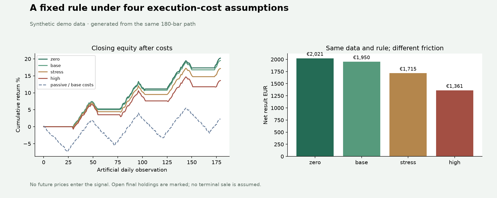

# Reproducible backtesting experiment

Synthetic demo data.

Question: how does a fixed long/cash moving-average rule change when execution costs increase?

180 artificial daily bars, seed 31, 5/12 close-based averages, €10,000 initial cash and 80% cash allocation.
Signals execute at the next open. The passive reference buys once at the first open with the same allocation,
cost scenario and horizon. Ending holdings are marked at the last close, with no assumed exit fee.

## Performance

| Scenario | Return | Max DD | Net EUR | Passive return | Difference pp |
|---|---:|---:|---:|---:|---:|
| zero | 20.21% | 2.15% | 2020.94 | 2.38% | 17.83 |
| base | 19.50% | 2.16% | 1950.23 | 2.29% | 17.21 |
| stress | 17.15% | 2.53% | 1714.67 | 1.99% | 15.15 |
| high | 13.61% | 3.40% | 1360.63 | 1.56% | 12.05 |

## Activity and cost assumptions

| Scenario | Fee / spread / slippage bps | Completed / open | Turnover | Execution costs EUR |
|---|---|---|---:|---:|
| zero | 0 / 0 / 0 | 3 / 1 | 6.144 | 0.00 |
| base | 5 / 8 / 2 | 3 / 1 | 6.134 | 67.48 |
| stress | 15 / 20 / 20 | 3 / 1 | 6.042 | 271.82 |
| high | 30 / 40 / 50 | 3 / 1 | 5.950 | 594.63 |

Spread is the full quoted spread; each fill pays half plus adverse slippage. Fees use executed notional.
Spread/slippage are already in fill prices and are not debited a second time. Total execution costs are
fees plus spread and slippage impact. Turnover is both-side executed notional divided by initial capital.
Max DD uses close-sampled equity and initial capital; it does not describe an unobserved intraday path.
Completed counts full round trips; open counts the remaining entry. Whole-unit affordability can alter sizes between cost scenarios.

Dataset SHA-256:

```text
664d2270daacf26a3e184126f8729a08c47fc316cc831d77eed022d2c3282bbf
```

[Full precision results](summary.json) · [Data](dataset.csv) · [Fills](fills.csv) · [Equity](equity.csv) · [Events](events.json)



All values above are generated by `backtest_demo.py`. Windows and cost cases are fixed demonstration choices,
not a calibrated strategy or an estimate of actual execution costs. Missing daily bars fail validation.
Use `terminal='liquidate'` in the API to model a precommitted final-close sale for both models, including its friction.
